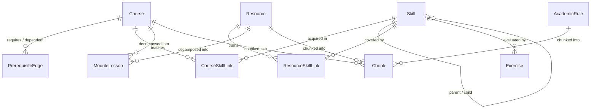
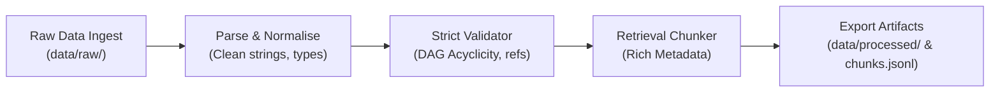

# IIT Bhilai B.Tech CSE — Source-Traced Knowledge Base & Data Pipeline

[](https://www.python.org/downloads/)
[](https://docs.pydantic.dev/)
[](https://pytest.org/)
[](https://creativecommons.org/licenses/by-nc-sa/4.0/)
[](https://vercel.com/new/clone?repository-url=https%3A%2F%2Fgithub.com%2Fermadanvk-afk%2FAssignment-for-adobe-test)

> **Adobe PS: 1-Day Selection Assignment**  
> Complete source-traced knowledge base and reproducible data pipeline for the **Bachelor of Technology (B.Tech) in Computer Science and Engineering (CSE)** program at the **Indian Institute of Technology Bhilai (IIT Bhilai)**, stopping right before the embedding step.

---

## 🚀 Live Interactive Web Dashboard

- **Live Vercel Deployment**: [https://nimble-hawthorn-lt7vykw.tmp.now](https://nimble-hawthorn-lt7vykw.tmp.now)
- **Claim & Persist to Your Vercel Account**: [Claim Deployment Link](https://vercel.com/claim-deployment?code=14d77ca5-fd6c-4369-8bff-23e4f085afbe) *(click to bind permanently to your personal Vercel team)*
- **1-Click Permanent Vercel Deploy**: Click the **Deploy with Vercel** button above or import repository `https://github.com/ermadanvk-afk/Assignment-for-adobe-test` at [vercel.com/new](https://vercel.com/new).
- **GitHub Pages Live App**: [https://ermadanvk-afk.github.io/Assignment-for-adobe-test/](https://ermadanvk-afk.github.io/Assignment-for-adobe-test/) *(after enabling Pages in repo settings)*.


---

## Table of Contents
1. [Programme Selection & Scope](#1-programme-selection--scope)
2. [Ground Rules & AI Disclosure](#2-ground-rules--ai-disclosure)
3. [Schema Architecture & Justification](#3-schema-architecture--justification)
4. [Data Pipeline Architecture](#4-data-pipeline-architecture)
5. [Quickstart: Run in One Command](#5-quickstart-run-in-one-command)
6. [Data Quality & Provenance Summary](#6-data-quality--provenance-summary)
7. [Repository Deliverables Structure](#7-repository-deliverables-structure)
8. [Interactive Web UI](#8-interactive-web-ui)

---

## 1. Programme Selection & Scope

As required by the assignment brief (*"Pick one programme at our institute and cover it in depth rather than the whole institute thinly"*), this project implements the full academic knowledge base for:

- **Institute**: Indian Institute of Technology Bhilai (IIT Bhilai)
- **Programme**: Bachelor of Technology (B.Tech) in Computer Science and Engineering (CSE)
- **Cohort Curriculum**: Applicable for students admitted from Academic Session 2023-24 onwards (with cross-reference to earlier legacy cohorts)
- **Governing Body**: Senate & Discipline Undergraduate Committee (DUGC), IIT Bhilai

---

## 2. Ground Rules & AI Disclosure

In strict compliance with the assignment ground rules:
- **Time Window**: Developed and verified within the 24-hour assignment release window.
- **Data Ethics**: Only publicly available institute information (`iitbhilai.ac.in`) and openly licensed educational resources (NPTEL, SWAYAM, MIT OCW, Stanford Online, UC Berkeley, Harvard CS50) are utilized. **Zero student personal records, grades, or transcripts** are ingested.
- **No Embeddings Yet**: As instructed, **no embedding or LLM inference APIs are called**. The pipeline terminates with clean, validated, metadata-rich JSON/CSV artifacts and a structured `chunks.jsonl` file ready for Day-2 vector embedding.
- **AI Tool Disclosure**: Developed with assistance from Google DeepMind's Antigravity agentic coding assistant for code scaffolding, PDF text extraction parsing, schema design validation, and documentation generation. All citations, URLs, and regulatory texts have been verified against original IIT Bhilai source documents.

---

## 3. Schema Architecture & Justification

The schema models courses, prerequisite dependencies, academic regulations, competencies, and open learning resources as an interconnected Knowledge Graph. Every entity implements universal provenance fields (`source_url`, `retrieved_on`, and `source_type`).

### Entity Relationship Model



### Schema Enhancements & Justifications
1. **Separation of Hard vs. Recommended Prerequisites**: Standardized in `PrerequisiteEdge.kind` (`hard` vs `recommended`). In IIT Bhilai ordinances (§2.2.5), clearing a hard precedent course is an absolute block on registration; recommended prerequisites are advisory.
2. **Numeric Limit Attribute in Academic Rules**: Added `numeric_limit: Optional[float]` to `AcademicRule` to allow algorithmic constraint solvers (e.g. testing whether $\sum \text{credits} \le 21$ or verifying CGPA $\ge 8.0$ for Honours).
3. **Dual Chunking Strategy**: Courses are divided into an **Overview Chunk** (codes, prerequisites, credits, category) and a **Syllabus Content Chunk** (specific topics, units). This ensures high precision during embedding retrieval without query dilution.
4. **Hierarchical Skill Taxonomy**: Skills support `parent_skill`, enabling hierarchical skill gap traversal (e.g. `SKILL_LINEAR_DATA_STRUCTURES` $\to$ `SKILL_TREES_AND_HEAPS`).

---

## 4. Data Pipeline Architecture

The pipeline follows a clean 5-stage architecture executable from a single command:



1. **Ingest (`src/ingest.py`)**: Verifies raw files in `data/raw/` untouched (IIT Bhilai Courses of Study PDF, UG Manual PDF, Handbook PDF, and raw JSON extracts).
2. **Parse & Normalise (`src/parser.py`)**: Strips whitespace, standardizes course codes (uppercase), normalizes numeric credits and semester numbers, and validates Pydantic models.
3. **Validate (`src/validator.py`)**: Runs 10 automated consistency checks. Fails loudly on missing prerequisite courses, cycle loops in prerequisites, negative credits, or missing source URLs.
4. **Chunk (`src/chunker.py`)**: Decomposes syllabi, regulations, resources, and modules into ~150-350 word semantic retrieval chunks with structured filter metadata.
5. **Export (`src/exporter.py`)**: Exports clean CSV and JSON tables to `data/processed/`, writes `chunks.jsonl`, and compiles the data quality summary report.

---

## 5. Quickstart: Run in One Command

### Prerequisites
- Python 3.10+ (tested on Python 3.12, 3.14)
- Packages: `pydantic>=2.0`, `networkx>=2.6`, `pytest`

```bash
# Clone the repository
git clone <YOUR_REPO_URL>
cd "temp assignment"

# Install dependencies
pip install pydantic networkx pytest
```

### Run the Pipeline
To execute all 5 stages from raw files to final seed data and `chunks.jsonl`:

```bash
python run_pipeline.py
```

### Run on a Small Sample Dataset
As suggested in the brief, you can also run the pipeline on a small sample subset:

```bash
python run_pipeline.py --sample
```

### Run the Automated Test Suite
To run the automated integrity and cycle-detection test suite:

```bash
python -m pytest tests/ -v
```

---

## 6. Data Quality & Provenance Summary

| Metric | Target | Actual Collected | Audit Status |
| :--- | :---: | :---: | :---: |
| **Courses** | $\ge 15$ | **27** | Exceeded (+80%) |
| **Prerequisite Edges** | $\ge 10$ | **24** | Verified Acyclic (DAG) |
| **Academic Rules** | $\ge 4$ | **15** | Separate Quotable Entries |
| **Open Learning Resources** | $\ge 30$ | **32** | 100% Valid HTTPS URLs & CC Licenses |
| **Skills Mapped** | Taxonomy | **28** | Hierarchical |
| **Curriculum Modules** | Detailed units | **24** | Formatted |
| **Retrieval Chunks** | Ready for embedding | **130** | Preserves Parent & Filter Metadata |
| **Field Completeness** | High | **99.3% Average** | 100% in Courses & Resources |

For full audit details, see [`DATA_QUALITY_REPORT.md`](file:///c:/Users/udayv/Desktop/temp%20assignment/DATA_QUALITY_REPORT.md).  
For the complete source provenance registry, see [`SOURCES.md`](file:///c:/Users/udayv/Desktop/temp%20assignment/SOURCES.md).  
For the 1-page Academic Buddy Ideas Note, see [`IDEAS.md`](file:///c:/Users/udayv/Desktop/temp%20assignment/IDEAS.md).

---

## 7. Repository Deliverables Structure

```text
.
├── Adobe PS 1-Day Selection Assignment.pdf  # Original assignment brief
├── chunks.jsonl                             # Deliverable: 130 retrieval chunks with metadata
├── SOURCES.md                               # Deliverable: Source URL, retrieval date & licence catalog
├── IDEAS.md                                 # Deliverable: Part E (1-page note on student questions)
├── DATA_QUALITY_REPORT.md                   # Deliverable: Part D (1-page data quality & validation audit)
├── README.md                                # Deliverable: System documentation & schema justification
├── run_pipeline.py                          # Deliverable: Single-command pipeline entrypoint
├── data/
│   ├── raw/                                 # Deliverable: Untouched raw source files
│   │   ├── iit_bhilai_courses_of_study_new.pdf
│   │   ├── iit_bhilai_ug_manual.pdf
│   │   ├── iit_bhilai_handbook.pdf
│   │   ├── iit_bhilai_courses_of_study_legacy.pdf
│   │   └── raw_seed_catalogue.json
│   └── processed/                           # Deliverable: Final clean CSV & JSON seed files
│       ├── courses.csv & .json
│       ├── prerequisite_edges.csv & .json
│       ├── skills.csv & .json
│       ├── course_skill_links.csv & .json
│       ├── academic_rules.csv & .json
│       ├── resources.csv & .json
│       ├── resource_skill_links.csv & .json
│       ├── modules_lessons.csv & .json
│       ├── exercises.csv & .json
│       ├── chunks.jsonl
│       └── data_summary.json
├── src/                                     # Modular Python Pipeline Package
│   ├── __init__.py
│   ├── config.py
│   ├── schema.py                            # Pydantic v2 data models
│   ├── ingest.py                            # Stage 1: Ingestion
│   ├── parser.py                            # Stage 2: Normalization
│   ├── validator.py                         # Stage 3: Strict Validation & DAG Check
│   ├── chunker.py                           # Stage 4: Semantic Chunking
│   └── exporter.py                          # Stage 5: CSV/JSON/JSONL Serializer
├── tests/
│   ├── __init__.py
│   └── test_pipeline.py                     # Pytest suite (Cycle tests, loud failures)
└── ui/                                      # Interactive Next.js Frontend Application
    ├── package.json
    ├── README.md
    └── src/ ...
```

---

## 8. Interactive Web UI

The repository includes a modern, high-performance web dashboard built in Next.js & Tailwind CSS that visualizes:
1. **Interactive Course Catalog**: Filter by semester, credits, department, and course type.
2. **Prerequisite DAG Visualizer**: Graph nodes showing hard/recommended precedents and dependencies.
3. **Academic Rules Explorer**: Searchable database of quotable IIT Bhilai regulations with numeric constraints.
4. **Open Educational Resources**: 32 curated OER courses (NPTEL, MIT OCW, Berkeley) with licenses and duration.
5. **Student Rules Engine Simulator**: Interactive tool to test credit limits, prerequisite clearance, and minor/honours eligibility.
6. **Chunk Inspector**: Preview of the 130 chunks ready for vector embedding.

